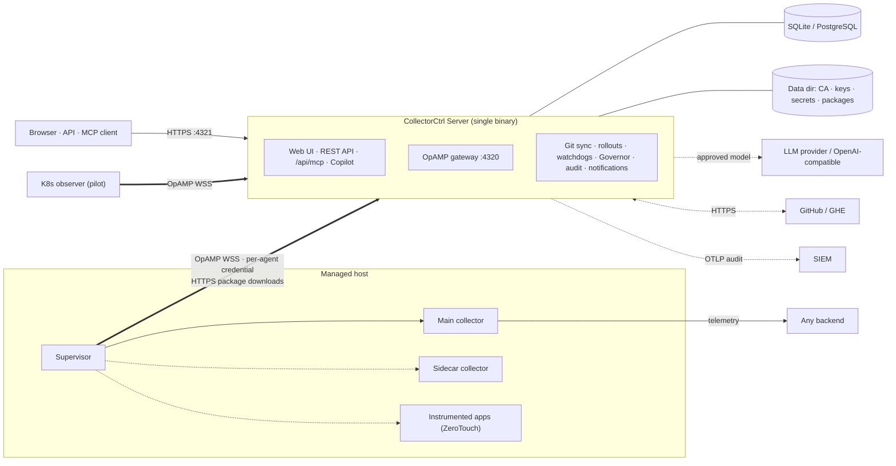

# CONTEXT: CollectorCtrl (public product repository)

Working context for teammates and AI assistants. Everything here comes from the files in this repository as of
**v0.6.3-beta** (23 October 2026). This repo contains **no product source code**: control-plane behaviour below is
*as documented*, not verified against code. Unconfirmed points are under [Open questions](#10-open-questions).

---

## 1. Purpose

The public face of CollectorCtrl, a self-hosted, vendor-neutral, OpAMP-based "agentic control plane for
OpenTelemetry" that manages OpenTelemetry Collector fleets. This repository holds:

- user documentation (`README.md`, `docs/`), release notes and changelog;
- the REST API specification (`docs/api/openapi.json`);
- examples (Docker Compose, GitOps policy file);
- a release-signature verification script;
- licensing (proprietary freeware), notices, issue/PR templates, security policy.

GitHub Releases on this repo carry the signed binaries and installers; the container image is
`ghcr.io/collectorctrl/collectorctrl-server`. CONTRIBUTING.md states the product source isn't public.

| Repo | Role | Relationship |
| --- | --- | --- |
| **CollectorCtrl** (this) | Docs, releases, OpenAPI, issues | Documents the server, Supervisor, Copilot, MCP |
| Control-plane source (private) | Server, Supervisor, web UI, `collectorctrl-mcp` adapter | Produces the release assets and image published here |
| CollectorCtrl-K8s-Operator (public, Apache-2.0) | Kubernetes observer (pilot) | Linked from README, `docs/setup.md#kubernetes`, `docs/features.md` |
| Website (collectorctrl.com) | Marketing and hosted docs | README links `/docs`; not covered here |

## 2. Tech stack

Of this repo:

| Item | Detail |
| --- | --- |
| Content | Markdown + Mermaid diagrams |
| API spec | OpenAPI `3.0.3`, `info.version` `1.4.0`, 214 paths, "generated from the server's enforced route catalog" |
| Script | `scripts/verify-release.py`: Python 3.8+, `cryptography` package (Ed25519) |
| Examples | Docker Compose with `postgres:15-alpine` |
| CI | None. `.github/workflows/docker-publish.yml` and `docker-server-image.yml` were deleted on 2026-09-01 |

Of the product (as documented):

| Component | Detail |
| --- | --- |
| Server | Single Go binary with embedded web UI; REST API, MCP endpoint, OpAMP gateway |
| Storage | SQLite (default) or PostgreSQL; auto-migrations at start-up |
| Protocol | OpAMP over WSS; includes software derived from `open-telemetry/opamp-go` (Apache-2.0, see `NOTICE`) |
| Supervisor | OS-native agent: Windows service, systemd unit, launchd daemon |
| Platforms | Windows, Linux, macOS (amd64, arm64); Docker (server only); Kubernetes single replica |
| Signing | Ed25519 detached `.sig` on every release file since v0.5.1-beta; SPDX 2.3 SBOMs since v0.6.3-beta |

## 3. Architecture (as documented)

The control plane never sits in the telemetry data path.

### Configuration flow (`docs/architecture.md`)

1. Change from UI, API, MCP (after approval) or Git merge.
2. Server resolves targets (policy selectors, overrides, canary cohort), validates YAML, stores a SHA-256-versioned version with history, writes audit.
3. Sent over OpAMP; offline collectors get it on reconnect.
4. Supervisor merges with local config, has the collector validate it, restarts only the changed pipeline (main or sidecar).
5. Applied hash reported back → delivered / confirmed / failed (with collector error).
6. Every heartbeat carries the effective-config hash; mismatch = drift → reported or reverted per policy.

### Focus areas (documented behaviour)

| Area | Summary | Source |
| --- | --- | --- |
| OpAMP server | Port 4320 WSS, `/v1/opamp`; 16 MB frame limit; per-agent failure isolation | `security.md`, `agent-onboarding.md` |
| Config versioning / rollout / canary | Label-selector policies (`matchLabels`, `matchExpressions`), SHA-256 versions, canary promote/abort (promotion needs every canary collector connected, assigned and on current version; force is audited), rollback = new version, optimistic concurrency | `features.md`, `RELEASE_NOTES.md` |
| Drift revert | Effective-config hash per heartbeat; report or auto-revert per policy; GitOps drift separately (report vs restore Git) | `features.md`, `gitops.md` |
| Self-healing | Validate-before-apply; crash-loop rollback to last known good | `features.md` |
| RBAC / OIDC | Admin/Editor/Viewer + custom roles, environment scoping, grant ceiling; OIDC presets (Okta, Entra ID, Google, Keycloak, Auth0), JIT, ordered group-to-role rules, break-glass local admins | `security.md` |
| Audit / SIEM | Hash-chained, verify integrity, CSV export; real-time OTLP log stream over TLS | `security.md` |
| Sidecar pipelines | Second collector per host, own executable, independent lifecycle and health | `agent-onboarding.md` |
| OCB integration | "Custom Builder" runs `ocb` from UI; output lands in package repo for signing/rollout | `features.md` |
| Telemetry Governor | Taps (default 10% sampling, trace-ID based), Insights (measured counts only), pattern/span optimizer, S3/OTLP destinations | `features.md`, `upgrading.md` |
| AI Copilot | Read-only tools on live data, streamed steps; proposes with diff + blast radius; providers OpenAI, Anthropic, Gemini, OpenAI-compatible; PII redaction | `ai-copilot-and-mcp.md` |
| MCP server | `POST /api/mcp` JSON-RPC 2.0, bearer API token, per-tool RBAC, audit actor `mcp:<user>`; stdio adapter `collectorctrl-mcp` (not yet in downloads) | `ai-copilot-and-mcp.md` |
| Human approval | Mutating tools create pending actions; approve in Settings → Pending AI Actions; needs `mcp:approve` + action permission/scope; API tokens can't approve; 15 min expiry; blast-radius cap (default 10); optional four-eyes; auto-approve needs env flag **and** `mcp:auto-approve` | `ai-copilot-and-mcp.md` |
| Storage | SQLite/PostgreSQL + data directory (CA, encryption key, session/OpAMP/tap secrets, package-signing key); settings encrypted at rest | `configuration.md` |

### Ports

| Port | Purpose |
| --- | --- |
| 4320 | OpAMP gateway (WSS) |
| 4321 | UI, REST API, MCP, onboarding scripts, CA, package downloads (HTTPS) |
| 5432 | PostgreSQL (if used) |
| 13133 | Collector health check (local on host) |

## 4. Repo map

| Path | What it is |
| --- | --- |
| `README.md` | Product overview, quick start, platforms, feature maturity, docs index |
| `RELEASE_NOTES.md` | Notes for the current release (v0.6.3-beta) only |
| `CHANGELOG.md` | One-line summary per release, 0.1.0-alpha → 0.6.3-beta; ⚠️ marks breaking |
| `docs/setup.md` | Server install: Docker, Compose, Windows, Linux, macOS, Kubernetes notes, first sign-in, troubleshooting |
| `docs/agent-onboarding.md` | Supervisor install/enrollment, `supervisor.yaml` reference, sidecar, ZeroTouch discovery |
| `docs/configuration.md` | Server env-var reference, TLS modes, data dir, dev-only switches |
| `docs/upgrading.md` | Upgrade order, breaking changes 0.5.x/0.6.x, backup/restore commands |
| `docs/features.md` | Full capability list as of v0.6.3-beta |
| `docs/ai-copilot-and-mcp.md` | Approval model, providers, MCP endpoint, tool list, runbook prompts |
| `docs/gitops.md` | GitHub/GHE sync, repo layout, `TelemetryPolicy` file format, webhook, API |
| `docs/architecture.md` | Components, config flow, identity, ports |
| `docs/security.md` | Transport, identity, auth, SSO, RBAC, AI guardrails, signing, audit, hardening checklist |
| `docs/verifying-downloads.md` | `.sig` format, release key history, verification, SBOMs |
| `docs/api/openapi.json` | REST API spec (~15k lines) |
| `examples/docker-compose.yml` | Production-mode server + PostgreSQL |
| `examples/gitops/templates/linux-hosts-production.yaml` | Example `TelemetryPolicy` |
| `scripts/verify-release.py` | Verifies a release file against its `.sig` |
| `LICENSE`, `NOTICE`, `third_party/licenses/` | Free-to-Use license; opamp-go attribution (Apache-2.0) |
| `SECURITY.md`, `CONTRIBUTING.md`, `CODE_OF_CONDUCT.md` | Policies |
| `.github/ISSUE_TEMPLATE/`, `.github/PULL_REQUEST_TEMPLATE.md` | Bug/feature forms, PR checklist |

## 5. Build, run and test

Nothing in this repo is built. Useful commands:

| Task | Command |
| --- | --- |
| Check the API spec parses | `python3 -c "import json; json.load(open('docs/api/openapi.json'))"` |
| Verify a release file | `pip install cryptography && python3 scripts/verify-release.py <file>` (`--key <hex>` for pre-0.5.3 releases) |
| Run server for evaluation | `docker run … ghcr.io/collectorctrl/collectorctrl-server:latest` (see README) |
| Run server + PostgreSQL | `examples/docker-compose.yml` with a `.env` containing the three required secrets, then `docker compose up -d` |
| Backup / restore | `collectorctrl-server -backup <file>` / `-restore <file> [-force]` |

There is no lint, link check or test suite. Release assets and the image are produced elsewhere (see Open questions).

### Environment variables (names only; values never belong in docs or commits)

| Group | Variables |
| --- | --- |
| Core | `COLLECTORCTRL_MODE`, `COLLECTORCTRL_ADMIN_PASSWORD`, `COLLECTORCTRL_DATA_DIR` |
| Database | `COLLECTORCTRL_DB_TYPE`, `COLLECTORCTRL_DB_DSN` |
| TLS | `COLLECTORCTRL_UI_TLS`, `COLLECTORCTRL_UI_HTTPS` (legacy), `COLLECTORCTRL_UI_CERT`, `COLLECTORCTRL_UI_KEY`, `COLLECTORCTRL_TLS_CERT`, `COLLECTORCTRL_TLS_KEY`, `COLLECTORCTRL_TLS_CA`, `COLLECTORCTRL_OPAMP_TLS`, `COLLECTORCTRL_OPAMP_BEHIND_PROXY` |
| Network | `COLLECTORCTRL_UI_ADDR`, `COLLECTORCTRL_OPAMP_ADDR`, `COLLECTORCTRL_URL`, `COLLECTORCTRL_ADVERTISE_HOST`, `COLLECTORCTRL_OPAMP_ENDPOINT`, `COLLECTORCTRL_ALLOWED_ORIGIN`, `COLLECTORCTRL_TRUST_PROXY_HEADERS` |
| Secrets | `COLLECTORCTRL_JWT_SECRET`, `COLLECTORCTRL_ENCRYPTION_KEY`, `COLLECTORCTRL_TAP_TOKEN_SECRET`, `OPAMP_SHARED_SECRET`, `OPAMP_SHARED_SECRET_PREVIOUS` |
| Agent auth | `OPAMP_LEGACY_MODE` |
| OIDC bootstrap | `COLLECTORCTRL_OIDC_ISSUER`, `_CLIENT_ID`, `_CLIENT_SECRET`, `_REDIRECT_URL`, `_ROLES_ADMIN`, `_ROLES_EDITOR`, `_ROLES_VIEWER` |
| AI / MCP | `COLLECTORCTRL_MCP_AUTO_APPROVE` |
| Other | `COLLECTORCTRL_OTLP_AUDIT_INSECURE`, `COLLECTORCTRL_ASSET_ALLOWED_HOSTS`, `COLLECTORCTRL_GOVERNOR_MAX_PAYLOAD_BYTES`, `COLLECTORCTRL_FRONTEND_DIR` |
| Supervisor host | `COLLECTORCTRL_ENROLL_TOKEN`, `OPAMP_SHARED_SECRET` (legacy) |
| Dev only | `OPAMP_AUTH_DISABLED`, `COLLECTORCTRL_ALLOW_UNSIGNED_PACKAGES` |
| Compose | `POSTGRES_PASSWORD` |

## 6. Domain concepts

| Term | Meaning |
| --- | --- |
| Collector | Any OTel Collector binary (upstream, vendor, `ocb` build). Use this word in user-facing text |
| Supervisor | Host agent that owns the collector's lifecycle and the OpAMP connection |
| Main / sidecar collector | Two independently supervised collectors on one host (e.g. observability vs SIEM pipeline) |
| Fleet policy / `TelemetryPolicy` | Label-selector-targeted config; GitOps files use `apiVersion: collectorctrl.io/v1alpha1` |
| Override | Per-collector settings keyed by `metadata.instanceId` |
| Canary | Share of matching collectors that gets a new version first; promote or abort |
| Drift | Effective-config hash ≠ governed config (or Git ≠ CollectorCtrl for GitOps) |
| Fleet Classification Rules | Ordered rules setting `collectorctrl.environment` and `collectorctrl.role`; environments are case-insensitive; unclassified = `unknown` |
| Enrollment token / per-agent credential / API token | `cce_…` (expires, limited uses) / `cca_…` (bound to instance UID) / `cc_…` (role + optional environment scope) |
| Pending AI action | Proposal from Copilot/MCP awaiting human approval |
| Blast radius | Number of collectors a proposal would affect |
| Telemetry Governor | Taps → Insights → optimizer → destinations |
| ZeroTouch | Application discovery + OTel agent attach (Java, .NET, Node.js, Python); alpha |
| Legacy mode | Shared-secret agent auth kept only as a migration window |
| Data directory | Per-install CA, keys, secrets; losing it forces re-enrollment |

Terminology note: the product UI and docs still use "agent" in fixed labels (Agent Enrollment, per-agent credential,
`fleet_*_agent` tool names). Keep those exact when referencing UI/API names; otherwise write "collectors".

## 7. Conventions

- **Docs style** (as practised in recent PRs): plain, short sentences; tables over prose; bold for UI labels; UI paths as **Settings → X**; `<version>` / `<arch>` placeholders; `example.com` hosts; `cc_your_token`-style placeholders.
- **Every version-specific statement names its version** ("since v0.5.3-beta", "v0.6.3-beta (23 October 2026)"). README banner, `features.md`, `SECURITY.md`, `RELEASE_NOTES.md` and `CHANGELOG.md` must move together on each release.
- **Breaking changes**: ⚠️ in CHANGELOG plus a section in `docs/upgrading.md` ("Changes to check in 0.X.x").
- **Feature maturity labels**: Beta / Alpha / Pilot / Not yet available (README table). Mark non-beta features in headings, e.g. *(alpha)*, *(pilot)*.
- **Security posture in docs**: secure defaults first; every weakening switch is labelled "development only" or "testing only".
- **Secrets**: generated with `openssl rand -hex 32`; never inline real values; contributors must redact tokens, keys and internal hostnames.
- **Branching**: `docs/<topic>` branches merged to `main` via PR (PRs #1–#3, Oct 2026). Earlier history was direct commits via the GitHub web UI.
- **PR template** (shared with product source): coding standards, tested on Windows and/or Linux, docs updated, no secrets, DB schema changes need auto-migration.
- **Licensing**: product is proprietary freeware; opamp-go-derived parts are Apache-2.0. Don't call CollectorCtrl "open source".

## 8. Current state

### Feature maturity (README)

| Status | Features |
| --- | --- |
| Beta | Fleet management, policies and canary rollouts, drift prevention, config history, GitOps, sidecars, supervisor/collector upgrades, package signing, Custom Builder, AI Copilot, MCP server, Telemetry Governor, SSO and RBAC, audit and SIEM streaming |
| Alpha | ZeroTouch instrumentation (.NET partial) |
| Pilot | Kubernetes workload observation (read-only) |
| Not yet available | Multi-replica HA; managing Kubernetes workload config |

Documented gaps: `collectorctrl-mcp` adapter not in release downloads; Windows installers have no SBOM in 0.6.3;
SBOM signing, npm/PostgreSQL SBOM contents and Docker image SBOM/cosign promised "from the next release"; GitOps
supports one repository and GitHub/GHE only; load-tested to 1,000 collectors.

TODO/FIXME: none in this repo.

### Recent direction (git log)

- Oct 2026: docs refreshed for v0.6.3-beta, licensing clarified, SBOM section added (PRs #1–#3).
- Releases accelerated from v0.5.1 (28 Sep) to v0.6.3 (23 Oct): security-by-default (0.5.x), Kubernetes visibility (0.6.x).
- Mid-2026: Telemetry Governor deploy files, Helm values and a K8s code folder were added and later removed from this repo.

### Claims to check against the product

These are statements users will rely on; confirm each in the server source before GA:

- [ ] Load-tested with 1,000 collectors; < 135 MB server memory on SQLite and PostgreSQL (Aug 2026)
- [ ] "60+" MCP tools and 5 runbook prompts; responses capped at 120 KB
- [ ] Blast-radius default 10; proposal expiry 15 min; API tokens can't approve
- [ ] Per-install CA ECDSA P-256 10 years; server cert 825 days, renewed within 30 days
- [ ] Enrollment token default expiry 24 h
- [ ] GitOps sync default 60 s; webhook needs `X-Hub-Signature-256`
- [ ] Governor tap default 10%; > 10,000 patterns returns 422
- [ ] Notification grouping above 5 per environment; 250 notifications kept per environment
- [ ] Supervisor accepts only release-signed supervisor packages
- [ ] OpAMP frame limit 16 MB
- [ ] macOS server and Supervisor (`.tar.gz`) and the Windows arm64 installers exist for every release
- [ ] OpenAPI `info.version` 1.4.0 matches the server's `/api/docs/openapi.json` for v0.6.3-beta
- [ ] Image publishes immutable `main-<commit>` tags (stated in `setup.md`)

## 9. Gotchas

- **No code here.** Don't infer implementation details from docs; check the private source.
- **Release-key history matters**: keys changed at 0.5.2 and 0.5.3; supervisors ≤ 0.5.2 must be upgraded once by hand. Keys live in `docs/verifying-downloads.md` and `scripts/verify-release.py`; changing one without the other breaks verification.
- **`RELEASE_NOTES.md` holds only the latest release**; older notes are on GitHub Releases. CHANGELOG links every tag.
- **Docker volume**: losing `/var/lib/collectorctrl` creates a new CA and locks out every enrolled collector. Never mount over `/opt/collectorctrl`.
- **Production mode** refuses to start without `COLLECTORCTRL_JWT_SECRET` and `COLLECTORCTRL_ENCRYPTION_KEY`, and refuses plaintext listeners on non-loopback addresses.
- **Windows**: config via the service's registry `Environment` value; data in `%PROGRAMDATA%\CollectorCtrl` (restrict ACLs); onboarding needs `curl.exe`; service names `CollectorCtrl` / `CollectorCtrlSupervisor`; server binary is `server.exe`.
- **Linux/macOS**: data dir defaults to the working directory unless `COLLECTORCTRL_DATA_DIR` is set; services `collectorctrl` / `collectorctrl-supervisor`; launchd `com.collectorctrl.supervisor`.
- **Kubernetes**: server single replica, PVC at `/var/lib/collectorctrl`, HTTPS probes on `/api/health`. Observer needs `opamp.enrollmentSecret`, retained PVC, one replica.
- **Environment names** became case-insensitive in 0.6.3; unclassified is `unknown`, but Governor S3 paths still use `environment=default`.
- **Policy/canary/GitOps MCP proposals** need an unscoped token.
- **Backups exclude env-supplied secrets** and the PostgreSQL database (take `pg_dump` too).
- **Image versioning**: README quick start uses `:latest`; there's no documented versioned image tag scheme beyond `main-<commit>`.
- **Docs mention `collectorctrl.com/docs`** as the canonical docs site; this repo and the site can drift.

## 10. Open questions

1. Where are release assets and the `ghcr.io/collectorctrl/collectorctrl-server` image built now that this repo's Docker workflows were deleted (2026-09-01)? Are semver image tags published?
2. Is `docs/api/openapi.json` regenerated automatically per release, and who owns that step?
3. Is the collectorctrl.com docs site generated from this `docs/` folder, or maintained separately?
4. Should this repo get a link checker / Markdown lint workflow?
5. When will `collectorctrl-mcp` ship in release downloads?
6. Version alignment: server 0.6.3-beta vs K8s operator 0.7.0 (chart 0.3.0). Is there a compatibility table?
7. GA target Jan–Feb 2027: which "Beta" features are expected to reach GA, and does Kubernetes observation leave "pilot"?
8. `SECURITY.md` here and in the operator repo list different reporting channels. Intended?
9. The PR template asks about coding standards and DB migrations, which don't apply to a docs-only repo. Keep or split?
